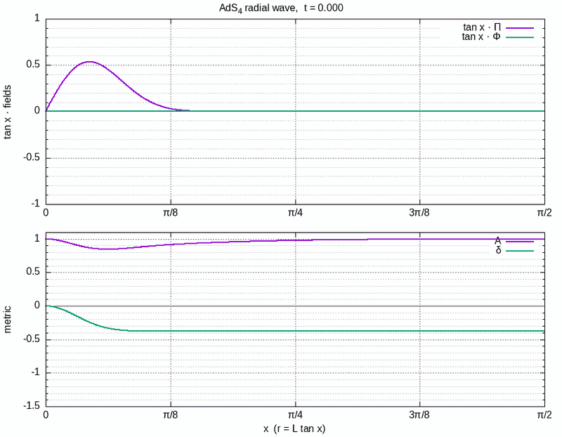

# Scalar field in AdS4

Numerical evolution of a massless, spherically symmetric scalar field in four-dimensional
Anti-de Sitter space, with and without gravitational backreaction. It follows the setup of
[Bizoń & Rostworowski, arXiv:1104.3702](https://arxiv.org/abs/1104.3702): finite differences in
space (4th order centred stencils), RK4 in time, and the metric functions `A` and `δ` recomputed
from the constraints at every Runge-Kutta stage.



A Gaussian pulse with backreaction (amplitude 20, `n = 1000`), up to the collapse at `t` = 21.95 (top: `tan x · Π` and
`tan x · Φ`; bottom: `A` and `δ`). The pulse bounces between the origin and the boundary and, as it keeps refocusing, steepens
into a front that moves in towards the origin. In the last frame `A` drops to about 0 at `x` ≈ 0.011 and `δ` plunges (the fields and `δ` are
clipped at the panel edge there). The y axes are fixed for the whole run. Weighting the fields by `tan x` keeps the
pulse visible at every radius, since `Π` and `Φ` themselves fall off like `1/tan x` away from the origin.

Reaching the collapse needs two things that the defaults do not give: a small time step, because the characteristic speed
`A e^{-δ}` is far above 1 where `δ` is large and negative (`cfl = 0.5` ends in NaN while `min A` is still 0.2 to 0.8), and every grid
point written to the output, because the final structure is only a few cells wide. To reproduce it (about five minutes for the
run):

```bash
./build/animation 1000 22 20 einstein 20 1001 0 100 0.025
gnuplot -e "weighted=1; ymin=-1; ymax=1; gmin=-1.5; gmax=1.1" scripts/animation.gp
```

## What I learned

The write-up is on the blog:
[Advanced Physics - Simulating field evolution in curved spacetimes](https://carequinha-wild-adventures.blogspot.com/2026/10/advanced-physics-simulating-field.html).
In short, for the radial equation `Π̇ = (tan²x · Φ)′ / tan²x`:

- Writing it as `Φ′ + 2Φ/(sin x cos x)` is **unstable for every time step**. A finite-difference stencil
  does not obey the product rule, and the defect is of order 1 on grid-scale oscillations. The growth
  rate near the ends is proportional to `1/dx`, so a finer grid blows up sooner.
- Differentiating the product `tan²x · Φ` and dividing afterwards removes that, but still has a slow growing mode at the
  first grid point. It shows up only after `t` of about 100 to 300, so a short run does not reveal it.
- Absorbing `tan x` into the fields (`Θ = tan x · Π`, `Ψ = tan x · Φ`) makes the semi-discrete operator
  skew-symmetric in the energy norm. Its eigenvalues are purely imaginary, and runs are stable to
  `T = 400` (`N = 500`).
- The 6th order 7-point stencil near the origin keeps the operator at least 4th order at every grid point.

The details, with derivations, measurements and the mistakes along the way, are in
[`docs/NOTES.md`](docs/NOTES.md).

## Build and run

```bash
git clone https://github.com/Convergence-Point/scalar-field-backreaction-ads4.git
cd scalar-field-backreaction-ads4
```

Requires `g++`, `make`, and `gnuplot` for the plots (with the `gif` and `pngcairo` terminals).

```bash
make                  # builds the animation program and the tests into build/   (make OPENMP=1 for OpenMP)
make check            # quick regression test, a few seconds
make test             # runs the convergence and boundary programs in tests/ (about 20 s; they print measured orders)
make animation        # default run (n=500, T=2 pi), then renders animation/wave.gif
                      # options: gnuplot -e "weighted=1; ymin=-1; ymax=1" scripts/animation.gp
make convergence      # self-convergence of the linear evolution, renders convergence/convergence.png
```

Run the programs from the repository root; they write to `animation/` and `convergence/`. For example, a
collapse with backreaction (the pulse returns to the origin at t = pi and collapses just after, t about 3.2):

```bash
./build/animation 500 6.2832 20 einstein 36
gnuplot scripts/animation.gp
```

All command-line arguments are described in [`docs/NOTES.md`](docs/NOTES.md#command-line-arguments).

## Layout

| Path | Contents |
|---|---|
| `src/` | The library: `derivative` (stencils and AdS operators), `evolution` (RK4), `einstein` (metric functions and right-hand sides), `structure` (grid and initial data) |
| `apps/` | `animation`, the program that writes the frames |
| `tests/` | Convergence and boundary checks: `test_convergence_linear`, `test_convergence_einstein`, `test_convergence_point`, `test_boundary_flat` |
| `scripts/` | gnuplot scripts that turn the output into `wave.gif` and `convergence.png` |
| `docs/` | `NOTES.md` with derivations and lessons learnt, and the animation shown above. The blog post is mirrored on a separate static site |
| `Makefile` | Build, `check`, `test`, and shortcuts for the animation and convergence runs |

## License

MIT, see [`LICENSE`](LICENSE).
